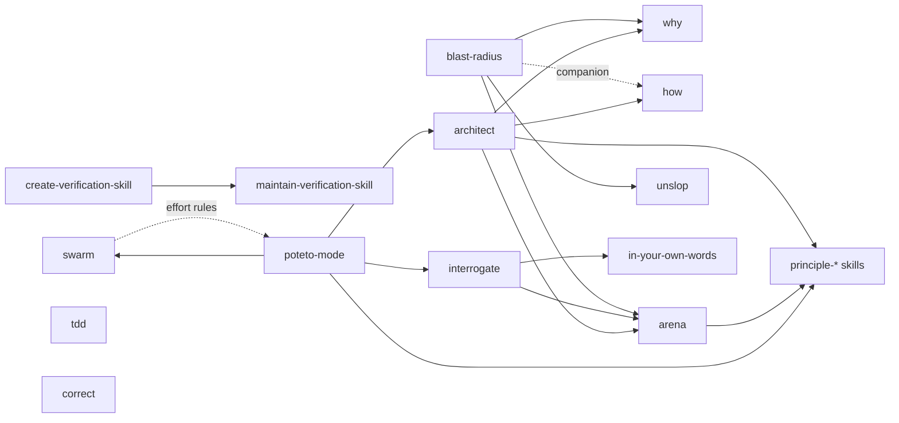
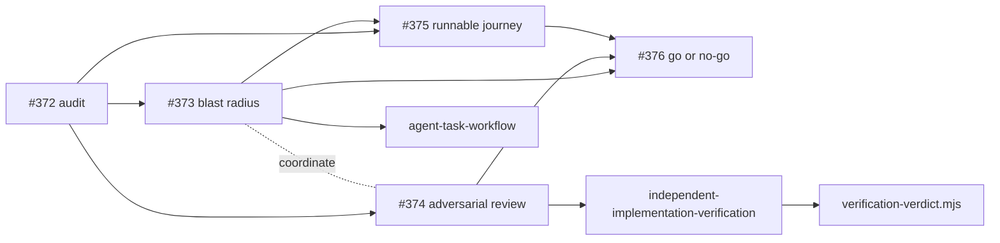

# pstack Applicability Audit

Decision record for [Issue #372](https://github.com/stevdrey/dokene/issues/372), first step of [Epic #371](https://github.com/stevdrey/dokene/issues/371). It decides which pstack practices Issues #373 to #375 may adapt. [Issue #376](https://github.com/stevdrey/dokene/issues/376) makes the final adoption decision from pilot evidence, so nothing here changes the current agent workflow.

## Outcome

| Decision | Upstream skills |
| --- | --- |
| Adopt as-is | None. Every useful skill needs Dokene-specific limits first. |
| Adapt | `blast-radius` (#373), `interrogate` (#374), `create-verification-skill` (#375), `tdd` (evidence format only) |
| Reject | `correct`, `architect`, `swarm`, `poteto-mode` |

Adapted practices are written in Dokene's own words under `.agents/skills/`. They are optional, risk-triggered additions to the existing workflow, not a second orchestrator.

## Sources inspected

Upstream text was treated as untrusted data. It was read through the GitHub REST API and stored as inert text outside the worktree. No installer, plugin, hook, or upstream script was run, no dependency was installed, and no upstream instruction was followed.

| Source | Revision | License |
| --- | --- | --- |
| [`backnotprop/pstack`](https://github.com/backnotprop/pstack/tree/08547969e1dffaa6457ea65141cc62c1d9a2eef1), the repository the Epic names. It is a mirror with harness-neutral rewrites ([README L14][readme-14]). | `08547969e1dffaa6457ea65141cc62c1d9a2eef1` (2026-11-10) | MIT, Copyright (c) 2026 Lauren Tan ([LICENSE][license]) |
| [`cursor/plugins/pstack`](https://github.com/cursor/plugins/tree/de8ee15dd1194627d21eb5fcd41cb1873208dabb/pstack), the primary source, plugin version 0.15.36. Used for provenance only. | `de8ee15dd1194627d21eb5fcd41cb1873208dabb` (2026-11-10) | MIT; `pstack/LICENSE` has the same blob as the mirror |
| Dokene baseline | `6c54473df1ea58ce050a6653f3083f4a99198193` | AGPL-3.0-or-later ([LICENSE](../../LICENSE)) |

| Skill file | Mirror blob | Identical in `cursor/plugins`? |
| --- | --- | --- |
| `skills/blast-radius/SKILL.md` | `b296cce0d746260a53c16e3671cb05bacfe82daf` | Yes |
| `skills/interrogate/SKILL.md` | `7d9674b72b159e6c4ff5e6c177f583680b935242` | No, mirror rewrite |
| `skills/create-verification-skill/SKILL.md` | `442292dc607c81a421a2714066c14a338e061500` | No, mirror rewrite |
| `skills/tdd/SKILL.md` | `ca6f24c963001d9d518db2936dfe3d12f29b4e94` | Yes |
| `skills/correct/SKILL.md` | `c45e06f48a0982ae19f92c6e83a8cd05988097a3` | Yes |
| `skills/architect/SKILL.md` | `eaff1d9c0947b4867b935874c38d5d6c2d8a6a33` | No, mirror rewrite |
| `skills/swarm/SKILL.md` | `9179d17e68384003cdbbdc2e55316f44d7d671a7` | No, mirror rewrite |
| `skills/poteto-mode/SKILL.md` | `53ecd5094538c52a855c09368390005a9405a70a` | No, mirror rewrite |

Existing Dokene guidance reviewed: [AGENTS.md](../../AGENTS.md), [.agents/README.md](../../.agents/README.md), [the skill index](../../.agents/skills/README.md), [`issue-implementation-loop`](../../.agents/skills/issue-implementation-loop/SKILL.md), [`independent-implementation-verification`](../../.agents/skills/independent-implementation-verification/SKILL.md), [`agent-task-workflow`](../../.agents/skills/agent-task-workflow/SKILL.md), [`create-pull-request`](../../.agents/skills/create-pull-request/SKILL.md), [security invariants](../security/security-invariants.md), and [the PR size guard](pr-size-guard.md).

## Decision matrix

| Skill | Decision | Dokene overlap | Keep | Do not bring over |
| --- | --- | --- | --- | --- |
| `blast-radius` | **Adapt** in #373 | Extends the risk and boundary review in `agent-task-workflow`. | Prove the one fact that makes a change safe, state how far the proof got, and list cleared risks separately ([L17-L27][br-17]). | The optional multi-model `arena` step ([L38][br-38]), the `why` and `unslop` dependencies, and its companion `how` ([L11][br-11]). |
| `interrogate` | **Adapt** in #374 | Adds an optional pass inside `independent-implementation-verification`. Does not replace the gate. | Report without fixing, prove findings by running them, and merge findings with one root cause ([L9][int-9], [L19][int-19], [L23][int-23]). | Fan-out through `arena` ([L17][int-17]). The verdict schema and validator stay the only gate. |
| `create-verification-skill` | **Adapt** in #375 | Fills a gap: no skill defines a runnable operator journey. Most existing `scripts/verify-*` files are tied to one Issue. | Doctor check, real-path evidence, cleanup that keeps the proof, and a proof run of the procedure ([L28-L31][cvs-28], [L40][cvs-40]). | The generator and the 3 to 5 feature map ([L36][cvs-36]). #375 covers one journey. No maintenance skill ([L44][cvs-44]). |
| `tdd` | **Adapt**, format only | `.agents/README.md` already requires tests for behavior changes. | Failing-before and passing-after evidence ([L38-L42][tdd-38]) as a form of implementer's evidence. | A separate skill or Issue, and the permission to skip a test ([L11][tdd-11], [L26][tdd-26]). |
| `correct` | **Reject** | The repository already enforces rules by script, such as the PR size and verdict tools. | Nothing new. | It mines history and then changes the repository in several commits ([L15][cor-15], [L26][cor-26]), and it edits agent instructions on each correction ([L30][cor-30]). That is unscoped work with no Issue. |
| `architect` | **Reject** | ADRs and `agent-task-workflow` own design decisions. | Nothing new. | Requires `arena`, with runners from a user-level settings file and a two-provider default ([L29-L31][arc-29]), and has no human checkpoint by default ([L43][arc-43]). |
| `swarm` | **Reject** | The verifier is already a fresh subagent. Native subagents cover parallel reads. | Nothing new. | Defaults to Cursor cloud workers ([L27][swa-27]) on a third-party default model ([L22][swa-22]). The Epic excludes mandatory swarm or arena. |
| `poteto-mode` | **Reject** | Would replace `AGENTS.md`, the loop, and the PR skill. | Nothing new. | Named as a non-goal by the Epic. Conflicts are listed below. |

## Trust boundaries and capabilities

A `SKILL.md` is a prompt, so its risk is what it tells an agent to do. All eight skills declare `disable-model-invocation: true` ([example][br-4]), meaning explicit invocation only upstream. Dokene keeps that property through the triggers below.

| Skill | Network or model egress | Arbitrary commands | Writes and side effects | Manual QA limit |
| --- | --- | --- | --- | --- |
| `blast-radius` | `gh` through `why` ([L33][br-33]). Code goes to other models through `arena` ([arena L17][are-17]). | Yes, writes and runs probes ([L37][br-37]). | Probe files only, kept outside the candidate worktree (rule 8). Strip private data before sharing ([L48][br-48]). | Level 5 needs a running app ([L27][br-27]). |
| `interrogate` | Code goes to every reviewer model, run as `arena` Phase B runners ([L17][int-17], [arena L17][are-17]). | Yes, each adversary runs repros ([L19][int-19]). | Extra worktrees with copies of uncommitted changes ([L17][int-17]), kept outside the candidate worktree (rule 8). | A design can be probed by prototype only. It is not QA. |
| `create-verification-skill` | Depends on the app. Dry-runs can still touch the network ([L30][cvs-30]). | Yes, launches and drives the app ([L27-L29][cvs-27]). | Generates skill files in a harness folder ([L9][cvs-9]). May add scaffolding ([L21][cvs-21]). | Neither `frontend/package.json` nor any CI workflow sets up a browser harness. Tracked browser drivers are local QA evidence scripts written for specific QA campaigns (the #122 `cdp.mjs` driver is reused by other #122 scripts and appears in #118 outputs), for example [#122](issue-122-evidence/scripts/README.md) and [#149](issue-149-evidence/scripts/sec149-browser.mjs); #375 should assess them first, since the skill prefers existing harnesses ([L17][cvs-17]). A proof run in a stand-in leaves its setup steps unverified ([L40][cvs-40]). |
| `tdd` | None required. | Project tests only. | One regression test. | Allows manual reproduction as a substitute ([L24][tdd-24]). |
| `correct` | `gh` and history reads. | Lints and CI commands. | Repository, CI, and agent rules ([L19-L22][cor-19]). | None. |
| `architect` | Multi-provider sketches. | Prototypes through `arena`. | Worktrees and implementation commits. | None. |
| `swarm` | Cursor cloud or other models ([L27][swa-27]). | Any command a worker brief asks for. | One worktree per writing worker ([L31][swa-31]). | A worker report is not manual QA. |
| `poteto-mode` | Any MCP tool, chat, tickets ([L84][pot-84]). Reads local agent transcripts ([L111][pot-111]). | Runs `bun install` at runtime ([bootstrap L35-L38][boot-35]); dev dependencies float on `latest` ([package.json L13-L14][pkg-13]). | PR automation and merges ([Autopilot-full L156][pot-156], [`gh pr merge`][ship-8]). | Depends on unshipped control skills ([L31][pot-31]). |

`npx skills add` ([README L37][readme-37]) and user-level model files such as `~/.claude/rules/pstack-models.md` ([arena L17][are-17]) are outside the repository's review boundary. Neither is used.

## Conflicts and resolution

Upstream text has no standing in the [`AGENTS.md` precedence order](../../AGENTS.md). Only an adapted skill merged into `.agents/skills/` counts, and then at the "applicable skills" level. Each conflict below resolves in favor of the Dokene rule.

| Topic | Upstream | Dokene rule that wins |
| --- | --- | --- |
| Human gate | Never block on reversible work ([poteto-mode L76][pot-76]), and external actions proceed without asking ([L84][pot-84]). | The loop returns `ask` for material gaps and waits. The verifier may not post or send messages. |
| Merge | A queue of PRs runs to merged ([L156][pot-156]). | [`issue-implementation-loop`](../../.agents/skills/issue-implementation-loop/SKILL.md) never merges, approves, or enables auto-merge. |
| Skill location | Harness folders, including `.claude/skills/` ([create-verification-skill L9][cvs-9]). | `.agents/skills/` is canonical. No `.claude/skills/`, `.cursor/skills/`, `.codex/skills/`, or `.pi/skills/` tree is proposed. |
| Test requirement | "Prefer no new test over a bad test" ([tdd L26][tdd-26]). | [`.agents/README.md`](../../.agents/README.md) requires appropriate tests for every behavioral change. Failing-before evidence is added on top of that. |
| Blocking bar | Leave out anything not run ([interrogate L19][int-19]). | #374 allows a failing test, command output, or a clearly evidenced contract violation. Anything else is a non-blocking risk. |
| Who gates | The orchestrator reruns and keeps findings ([interrogate L23][int-23]). | Adversarial output becomes `findings[]` in the existing verdict. `verification-verdict.mjs` computes the result. |
| Independence | Runners from different model families ([arena L17][are-17]). | Independence means a fresh agent without the implementer's context. Multi-provider review is not required. |
| Stopping | A plateau is not a stop ([autonomous-run L11][auto-11]). | `maxRounds`, the helper's `stop` action, and the review convergence rules end the loop. |
| Scope | Fix a broken checkout first ([create-verification-skill L21][cvs-21]). | Unrelated breakage is reported. Security controls and CI are never relaxed to make a journey pass. |
| Live effects | Verify messages sent ([create-verification-skill L30][cvs-30]). | [Invariants](../security/security-invariants.md) 3, 4, 8, 24, and 26 apply, and #375 forbids live Meta messages and real customer data. Assert that no send occurred. |

## Dependency graph

Upstream edges come from the skill text. The mirror's list of skills that work alone ([README L46-L48][readme-46]) is out of date for `interrogate`, which has run through `arena` since the 2026-10-28 sync ([SYNC-LOG L20][sync-20]).



Dokene's adaptation removes every edge above: the adapted practices depend only on existing Dokene skills.



## Risk-based invocation

The default is to invoke none of these. Use a practice only when its trigger holds, and record why. The budgets are starting values for the child Issues to confirm.

| Practice | Invoke when | Skip when | Starting budget |
| --- | --- | --- | --- |
| Blast radius | The change crosses two or more of API contract, persistence or migration, frontend behavior, authentication, RLS or tenant scope, and messaging side effects, or it touches a [security invariant](../security/security-invariants.md). | Documentation-only work, or a change inside one module with no contract or invariant impact. | One record and 1 or 2 executable probes. |
| Adversarial pass | The diff touches tenant isolation, authorization, PII, messaging idempotency, concurrency, migrations, or external integrations (the #374 triggers). | No trigger applies. | One pass per candidate, by the independent verifier, with no extra verification round. |
| Runnable journey | An operator-visible journey changes and only a running local stack can observe the effect. | Unit or integration tests already observe it. An unavailable local stack is not a skip: record the check as `not-run`, and the criterion it supports is `blocked`. | One journey per candidate. |
| Failing-before evidence | A bug fix has a cheap, existing local test path. | The change is not a bug fix. The required test still applies when this is skipped. | One regression test. |

## Evidence formats

Child Issues may refine these. They add no field to verdict schema version 1.

**Blast-radius record (#373).** Evidence level is one of `asserted`, `cited`, `reasoned`, `executed`, or `reproduced`, adapted from the upstream ladder ([L23-L27][br-23]).

```yaml
affected_boundaries: [api, persistence, frontend, auth, rls_tenant_scope, messaging]
safety_assumptions:
  - fact: "<the fact the change's safety depends on>"
    invariant: "<docs/security/security-invariants.md item or ADR>"
    level: executed
    evidence: "<file:line, or command and output>"
uncertainty: ["<unproven item, marked unverified>"]
cleared: ["<risk checked and why it is fine>"]
proposed_tests: ["<cheapest test that catches the real failure>"]
```

**Adversarial finding (#374).** The reproduction goes in the existing `findings[].evidence` field. `severity` is `blocker` only with reproducible proof or a clearly evidenced contract violation. [`adversarial-review.md`](../../.agents/skills/independent-implementation-verification/adversarial-review.md#reproduction-format) refines it with a `root_cause` line used to merge findings with one cause.

```yaml
location: "<file:line>"
invariant: "<contract or invariant broken>"
steps: "<exact command or probe>"
actual: "<redacted output>"
expected: "<required behavior>"
severity: blocker | optional
confidence: high | medium | low
candidate: "<base, head, and tree from verification-verdict.mjs --identity>"
```

**Journey run (#375).** `kind` uses the existing check kinds. A step that did not execute has `result: not-run`, as in the verdict schema.

```yaml
journey: "<operator journey>"
fixture: "<seed command and invented data>"
actors: ["<role and tenant>"]
steps:
  - action: "<observable action>"
    expected: "<state or response>"
    actual: "<redacted result>"
    kind: automated | manual | simulated | live
    result: passed | failed | not-run
outbound_sends: 0
cleanup: "<what was removed and where the evidence remains>"
```

**Failing-before evidence.** Record the test name, the failure before the fix, and the passing run after it, as implementer's evidence for the verifier to check.

## Manual QA limitations

This audit read documents and ran no application, browser journey, or manual QA. It does not show that any practice finds defects; #376 owns that measurement. An agent run or subagent report counts as manual or browser QA only if that QA actually ran and is recorded as such. The `live` check kind is limited to a safe test environment, and a real WhatsApp send stays out of agent workflows unless a human runs [the live procedure](phase-3-live-meta-procedure.md).

## Authoritative controls

No adapted practice can pass, waive, or replace any control below. This audit changes none of them.

| Control | Enforcement point |
| --- | --- |
| PR size: 30 target, 40 hard limit | [`PR file count` job](../../.github/workflows/pr-size-guard.yml), with local preflight through [`pr-size-preflight.mjs`](../../.agents/scripts/pr-size-preflight.mjs) |
| Independent verification | [Skill](../../.agents/skills/independent-implementation-verification/SKILL.md) and [`verification-verdict.mjs`](../../.agents/scripts/verification-verdict.mjs) |
| Loop termination and no merge | [Skill](../../.agents/skills/issue-implementation-loop/SKILL.md) and [`issue-loop.mjs`](../../.agents/scripts/issue-loop.mjs) |
| Backend and frontend CI | [`backend.yml`](../../.github/workflows/backend.yml), [`frontend.yml`](../../.github/workflows/frontend.yml), [`scripts.yml`](../../.github/workflows/scripts.yml), [`pr-preflight-tests.yml`](../../.github/workflows/pr-preflight-tests.yml) |
| Security scanning | [`security.yml`](../../.github/workflows/security.yml), [`codeql.yml`](../../.github/workflows/codeql.yml), [`dependency-check.yml`](../../.github/workflows/dependency-check.yml) |
| Security and architecture rules | [Security invariants](../security/security-invariants.md), [threat model](../security/threat-model.md), and accepted [ADRs](../adr/) |

[`.claude/settings.json`](../../.claude/settings.json) and [`.codex/hooks.json`](../../.codex/hooks.json) are thin hook pointers to `.agents/scripts/`, and [`CLAUDE.md`](../../CLAUDE.md) and [`.github/copilot-instructions.md`](../../.github/copilot-instructions.md) are discovery pointers. These four are the only tracked provider-specific entries, and none holds a skill.

## Rules for child Issues

1. Write adapted guidance in Dokene's own words. If a substantial part of upstream text is copied, keep the MIT copyright and permission notice with it.
2. Do not install, vendor, or run pstack, its plugin, its scripts, or its Bun dependencies.
3. Add no provider-specific skill directory and no user-level model settings.
4. Keep adapted skills dependent on existing Dokene skills only.
5. Do not send repository content to a provider beyond those already configured for the agent in use.
6. Pin any new upstream reading to a commit and treat it as untrusted. A refreshed reading needs this audit updated.
7. Change the skill index only as #376 allows, for improvements the pilot proved.
8. Write probes, repro scripts, adversary worktrees, and journey evidence outside the candidate worktree. The candidate identity includes untracked files, so a file left inside makes the verdict stale, and the verifier may not edit the worktree.

## Limitations

- The audit covers the eight named skills, `arena`, the dependencies cited above, and the mirror's README, LICENSE, and sync log.
- Scripts were reviewed only as far as these decisions needed. `poteto-mode`'s `watch-pr` TypeScript was not audited, because the skill is rejected.
- Five of the eight skill files differ between the mirror and `cursor/plugins`. Citations refer to the mirror the Epic names.

[readme-14]: https://github.com/backnotprop/pstack/blob/08547969e1dffaa6457ea65141cc62c1d9a2eef1/README.md#L14
[readme-37]: https://github.com/backnotprop/pstack/blob/08547969e1dffaa6457ea65141cc62c1d9a2eef1/README.md#L37
[readme-46]: https://github.com/backnotprop/pstack/blob/08547969e1dffaa6457ea65141cc62c1d9a2eef1/README.md#L46-L48
[license]: https://github.com/backnotprop/pstack/blob/08547969e1dffaa6457ea65141cc62c1d9a2eef1/LICENSE
[sync-20]: https://github.com/backnotprop/pstack/blob/08547969e1dffaa6457ea65141cc62c1d9a2eef1/SYNC-LOG.md#L20
[br-11]: https://github.com/backnotprop/pstack/blob/08547969e1dffaa6457ea65141cc62c1d9a2eef1/skills/blast-radius/SKILL.md#L11
[br-4]: https://github.com/backnotprop/pstack/blob/08547969e1dffaa6457ea65141cc62c1d9a2eef1/skills/blast-radius/SKILL.md#L4
[br-17]: https://github.com/backnotprop/pstack/blob/08547969e1dffaa6457ea65141cc62c1d9a2eef1/skills/blast-radius/SKILL.md#L17-L27
[br-23]: https://github.com/backnotprop/pstack/blob/08547969e1dffaa6457ea65141cc62c1d9a2eef1/skills/blast-radius/SKILL.md#L23-L27
[br-27]: https://github.com/backnotprop/pstack/blob/08547969e1dffaa6457ea65141cc62c1d9a2eef1/skills/blast-radius/SKILL.md#L27
[br-33]: https://github.com/backnotprop/pstack/blob/08547969e1dffaa6457ea65141cc62c1d9a2eef1/skills/blast-radius/SKILL.md#L33
[br-37]: https://github.com/backnotprop/pstack/blob/08547969e1dffaa6457ea65141cc62c1d9a2eef1/skills/blast-radius/SKILL.md#L37
[br-38]: https://github.com/backnotprop/pstack/blob/08547969e1dffaa6457ea65141cc62c1d9a2eef1/skills/blast-radius/SKILL.md#L38
[br-48]: https://github.com/backnotprop/pstack/blob/08547969e1dffaa6457ea65141cc62c1d9a2eef1/skills/blast-radius/SKILL.md#L48
[int-9]: https://github.com/backnotprop/pstack/blob/08547969e1dffaa6457ea65141cc62c1d9a2eef1/skills/interrogate/SKILL.md#L9
[int-17]: https://github.com/backnotprop/pstack/blob/08547969e1dffaa6457ea65141cc62c1d9a2eef1/skills/interrogate/SKILL.md#L17
[int-19]: https://github.com/backnotprop/pstack/blob/08547969e1dffaa6457ea65141cc62c1d9a2eef1/skills/interrogate/SKILL.md#L19
[int-23]: https://github.com/backnotprop/pstack/blob/08547969e1dffaa6457ea65141cc62c1d9a2eef1/skills/interrogate/SKILL.md#L23
[cvs-9]: https://github.com/backnotprop/pstack/blob/08547969e1dffaa6457ea65141cc62c1d9a2eef1/skills/create-verification-skill/SKILL.md#L9
[cvs-17]: https://github.com/backnotprop/pstack/blob/08547969e1dffaa6457ea65141cc62c1d9a2eef1/skills/create-verification-skill/SKILL.md#L17
[cvs-21]: https://github.com/backnotprop/pstack/blob/08547969e1dffaa6457ea65141cc62c1d9a2eef1/skills/create-verification-skill/SKILL.md#L21
[cvs-27]: https://github.com/backnotprop/pstack/blob/08547969e1dffaa6457ea65141cc62c1d9a2eef1/skills/create-verification-skill/SKILL.md#L27-L29
[cvs-28]: https://github.com/backnotprop/pstack/blob/08547969e1dffaa6457ea65141cc62c1d9a2eef1/skills/create-verification-skill/SKILL.md#L28-L31
[cvs-30]: https://github.com/backnotprop/pstack/blob/08547969e1dffaa6457ea65141cc62c1d9a2eef1/skills/create-verification-skill/SKILL.md#L30
[cvs-36]: https://github.com/backnotprop/pstack/blob/08547969e1dffaa6457ea65141cc62c1d9a2eef1/skills/create-verification-skill/SKILL.md#L36
[cvs-40]: https://github.com/backnotprop/pstack/blob/08547969e1dffaa6457ea65141cc62c1d9a2eef1/skills/create-verification-skill/SKILL.md#L40
[cvs-44]: https://github.com/backnotprop/pstack/blob/08547969e1dffaa6457ea65141cc62c1d9a2eef1/skills/create-verification-skill/SKILL.md#L44
[tdd-11]: https://github.com/backnotprop/pstack/blob/08547969e1dffaa6457ea65141cc62c1d9a2eef1/skills/tdd/SKILL.md#L11
[tdd-24]: https://github.com/backnotprop/pstack/blob/08547969e1dffaa6457ea65141cc62c1d9a2eef1/skills/tdd/SKILL.md#L24
[tdd-26]: https://github.com/backnotprop/pstack/blob/08547969e1dffaa6457ea65141cc62c1d9a2eef1/skills/tdd/SKILL.md#L26
[tdd-38]: https://github.com/backnotprop/pstack/blob/08547969e1dffaa6457ea65141cc62c1d9a2eef1/skills/tdd/SKILL.md#L38-L42
[cor-15]: https://github.com/backnotprop/pstack/blob/08547969e1dffaa6457ea65141cc62c1d9a2eef1/skills/correct/SKILL.md#L15
[cor-19]: https://github.com/backnotprop/pstack/blob/08547969e1dffaa6457ea65141cc62c1d9a2eef1/skills/correct/SKILL.md#L19-L22
[cor-26]: https://github.com/backnotprop/pstack/blob/08547969e1dffaa6457ea65141cc62c1d9a2eef1/skills/correct/SKILL.md#L26
[cor-30]: https://github.com/backnotprop/pstack/blob/08547969e1dffaa6457ea65141cc62c1d9a2eef1/skills/correct/SKILL.md#L30
[arc-29]: https://github.com/backnotprop/pstack/blob/08547969e1dffaa6457ea65141cc62c1d9a2eef1/skills/architect/SKILL.md#L29-L31
[arc-43]: https://github.com/backnotprop/pstack/blob/08547969e1dffaa6457ea65141cc62c1d9a2eef1/skills/architect/SKILL.md#L43
[swa-22]: https://github.com/backnotprop/pstack/blob/08547969e1dffaa6457ea65141cc62c1d9a2eef1/skills/swarm/SKILL.md#L22
[swa-27]: https://github.com/backnotprop/pstack/blob/08547969e1dffaa6457ea65141cc62c1d9a2eef1/skills/swarm/SKILL.md#L27
[swa-31]: https://github.com/backnotprop/pstack/blob/08547969e1dffaa6457ea65141cc62c1d9a2eef1/skills/swarm/SKILL.md#L31
[pot-31]: https://github.com/backnotprop/pstack/blob/08547969e1dffaa6457ea65141cc62c1d9a2eef1/skills/poteto-mode/SKILL.md#L31
[pot-76]: https://github.com/backnotprop/pstack/blob/08547969e1dffaa6457ea65141cc62c1d9a2eef1/skills/poteto-mode/SKILL.md#L76
[pot-84]: https://github.com/backnotprop/pstack/blob/08547969e1dffaa6457ea65141cc62c1d9a2eef1/skills/poteto-mode/SKILL.md#L84
[pot-111]: https://github.com/backnotprop/pstack/blob/08547969e1dffaa6457ea65141cc62c1d9a2eef1/skills/poteto-mode/SKILL.md#L111
[pot-156]: https://github.com/backnotprop/pstack/blob/08547969e1dffaa6457ea65141cc62c1d9a2eef1/skills/poteto-mode/SKILL.md#L156
[boot-35]: https://github.com/backnotprop/pstack/blob/08547969e1dffaa6457ea65141cc62c1d9a2eef1/skills/poteto-mode/scripts/bootstrap.ts#L35-L38
[pkg-13]: https://github.com/backnotprop/pstack/blob/08547969e1dffaa6457ea65141cc62c1d9a2eef1/skills/poteto-mode/scripts/package.json#L13-L14
[ship-8]: https://github.com/backnotprop/pstack/blob/08547969e1dffaa6457ea65141cc62c1d9a2eef1/skills/poteto-mode/playbooks/shipping.md#L8
[auto-11]: https://github.com/backnotprop/pstack/blob/08547969e1dffaa6457ea65141cc62c1d9a2eef1/skills/poteto-mode/playbooks/autonomous-run.md#L11
[are-17]: https://github.com/backnotprop/pstack/blob/08547969e1dffaa6457ea65141cc62c1d9a2eef1/skills/arena/SKILL.md#L17
